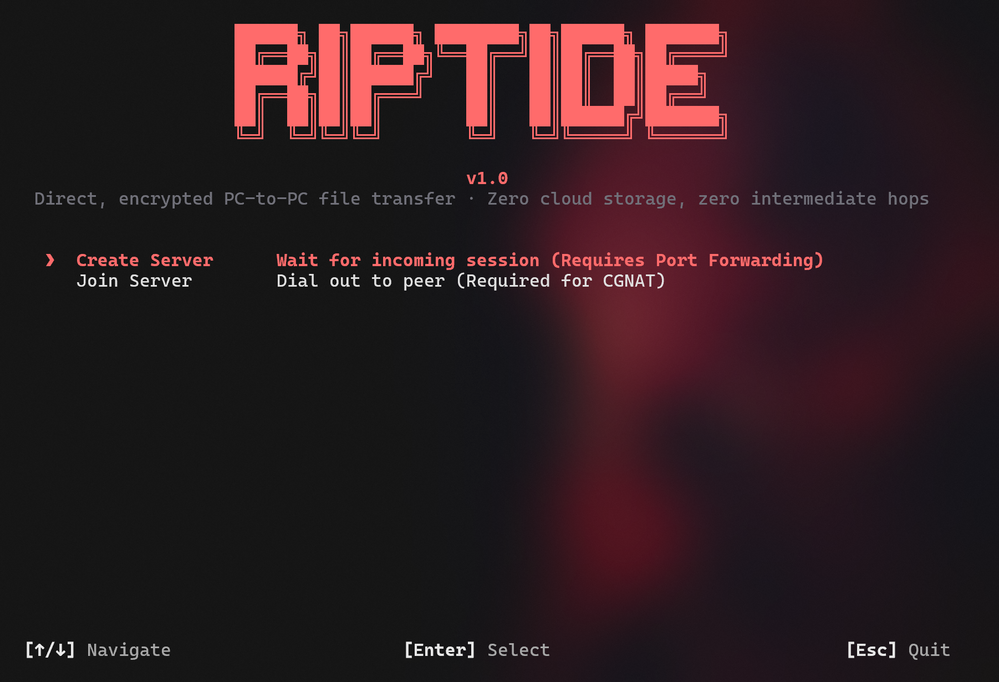
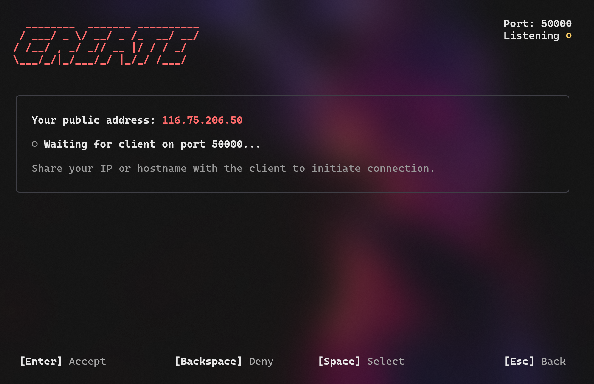
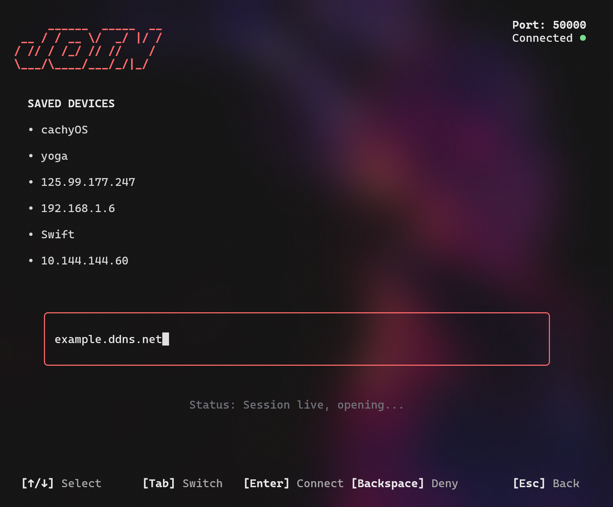
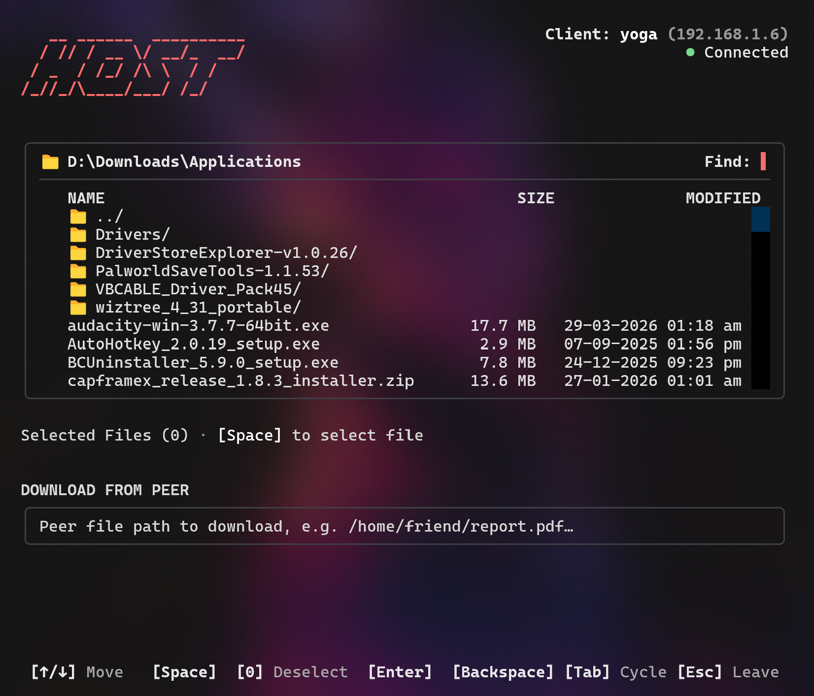

# Riptide

Riptide is a terminal program for direct, encrypted, PC to PC file transfer. Run `riptide` in a folder, connect two computers, and send files from one to the other over one encrypted TCP connection. Files go straight from sender to receiver. No server stores a copy in between.

The name comes from Minecraft. Riptide is the trident enchantment that launches the player forward at high speed. With an Elytra in rain, Riptide plus Elytra is the fastest travel method in Minecraft. Riptide the program aims for the same idea for files: the shortest route, from one PC to the other.

## Screenshots









## Features

- Direct session between two PCs. One side listens, the other dials in. Both sides must be online at the same time.
- Either side can send files after the session opens. File direction does not depend on connection direction.
- Multiple file selection. Select files with Space, send the batch with Enter.
- File manager with folders, live search in `Find:`, auto-highlight of the first file or folder, and `0` to deselect all.
- File requests with approval. Type a peer path, press Enter, and nothing is sent until the peer presses Allow.
- Saved connections. Peers, hostnames, and certificate fingerprints are saved in `~/.riptide/config.toml`. Saved devices appear on the Join Server page.
- Live progress with speed, transferred total, remaining size, and ETA, on sender and receiver.
- Hash verification. Each file is SHA-256 hashed before sending, written as `.part` on receipt, and renamed only if the hash matches.
- TLS encryption for headers and file bytes, with per-machine self-signed certificates.
- Fingerprint approval. First connection to a peer shows its certificate fingerprint for approval. A changed fingerprint later aborts the session.
- Public address display on Create Server.
- Dark grey terminal UI with a soft red accent, for Windows and Linux.

Security, in brief: TLS protects files in transit. Fingerprints authenticate peers. Download requests need explicit approval. Private keys stay in `~/.riptide/` at 0600 and are never stored in `config.toml`. Files on disk are not encrypted. A push after session approval does not ask per file, so only approve sessions for peers you trust. Full detail is in [Docs/Security](docs/security.md).

## Installation

GitHub only. Riptide is not published to PyPI.

Requirements: Python 3.11 or newer, `pipx`, `git`, Windows or Linux.

```sh
pipx install git+https://github.com/mohakps/riptide
```

Run it from the folder you want to send from or receive into:

```sh
riptide
```

Update:

```sh
pipx upgrade riptide
```

Uninstall:

```sh
pipx uninstall riptide
```

If upgrade fails, uninstall and install again.

## Usage

Create Server listens. Join Server dials. Create stays on top in the menu.

1. Create side: run `riptide`, choose Create Server, and share the public address shown on that page or your DDNS hostname with the other person. Keep the page open.
2. Join side: run `riptide`, choose Join Server, enter the host hostname or IP, or pick a saved device, and press Enter.
3. Approve the connection when asked, on either side.
4. Send: select files with Space in the file manager, press Enter. Request: type a peer path in Download From Peer, press Enter, and wait for the peer to Allow it.
5. Files arrive in the folder where the receiving side ran `riptide`.

If you are behind CGNAT, swap roles. Let the other side Create, and you Join. Full usage, shortcuts, and setup steps are in [Docs/Usage](docs/usage.md). Learn more about CGNAT or who should create server in [Docs/Architecture](docs/architecture.md).

### Shortcuts

| Key | Action |
| --- | --- |
| Up / Down | Move in a list |
| Space | Open a folder, or select a file |
| Enter | Send selected files, or Allow a pending connection |
| Backspace | Erase Find text, go up a folder when Find is empty, or Deny a pending connection |
| 0 | Deselect all files |
| Tab | Cycle between file list and download input |
| Esc | Back, or leave the session |

## Advantages

- One direct transfer, at bottleneck speed. No server in the middle to slow, throttle, or queue it.
- About half the time of a cloud transfer for large files. Cloud transfer is upload plus download. Direct transfer is one transfer.
- No account, storage quota, or file size limit from Riptide. Disk space is the limit.
- No third party holds a copy, so privacy does not depend on a provider policy.
- LAN speed when both PCs are on the same LAN, using a private LAN address.

Full details in [Docs/Advantages](docs/advantages.md).

## Limitations

- First setup on the Create side: port forward 50000 on the router, once, and DDNS if the public IP changes often. The PC firewall rule for port 50000 is checked and added automatically when you click Create Server, on Windows and Linux. If Riptide is not run as admin, or sudo needs a password, it asks once on that click: UAC on Windows, pkexec on Linux. If you cancel, or it cannot add the rule, the Create page shows the exact manual command. Only rules that explicitly mention port 50000 are checked and opened. Any-port rules are ignored.
- No direct connection between two CGNAT devices on IPv4, unless both have global IPv6. There is no relay fallback.
- Folders cannot be sent yet. Zip a folder first, or select its files one by one.
- No resume for an interrupted file. It restarts from the start.
- One file at a time, in batch order. No parallel streams.
- Both sides must be online together. No offline queue.
- You must exchange the host address outside Riptide, by message or DDNS hostname.
- Terminal only, Windows and Linux primarily. macOS is not specifically tested.

Full detail, with workarounds where they exist, is in [Docs/Limitations](docs/limitations.md).

## Project structure

```
riptide/
├── src/riptide/
│   ├── app.py
│   ├── theme.py
│   ├── screens/
│   │   ├── menu.py
│   │   ├── create.py
│   │   ├── join.py
│   │   └── session_screen.py
│   └── core/
│       ├── session.py
│       ├── identity.py
│       ├── nat.py
│       ├── config.py
│       ├── file_select.py
│       ├── firewall.py
│       ├── focus.py
│       └── transfer.py
├── tests/
├── REMOVED.md
└── README.md
```

For detail structure, read [Docs/Project structure](docs/project-structure.md).

## How this was built

- Meta Muse: primary assistant for panning, implementation, testing, and documentation.
- Gemini 3.8 Flash: TUI Design

Human decisions, testing on real machines, and final choices about names, ports, and behaviour are the author's. AI-generated code was tested, not trusted blindly. The test suite and headless Textual pilots are part of the workflow, and live two-machine testing is what proves a transfer.

## Docs

- [Architecture](docs/architecture.md)
- [Security](docs/security.md)
- [Advantages](docs/advantages.md)
- [Limitations](docs/limitations.md)
- [Troubleshooting](docs/troubleshooting.md)
- [Sources and references](docs/sources-references.md)
