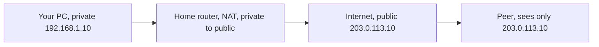
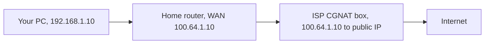
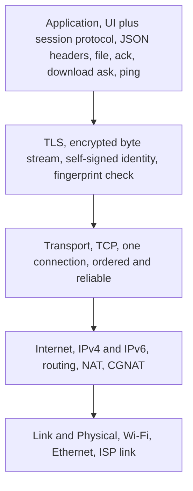
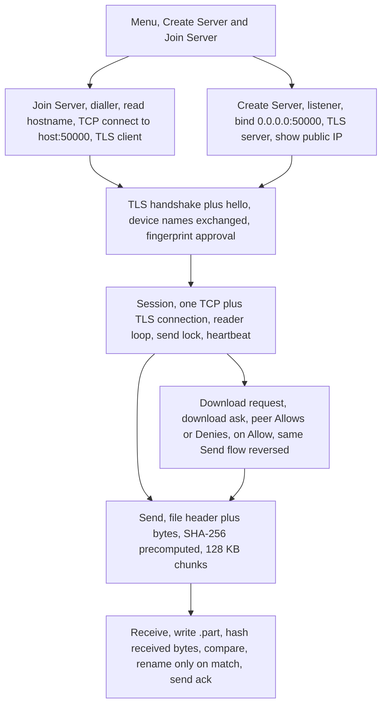
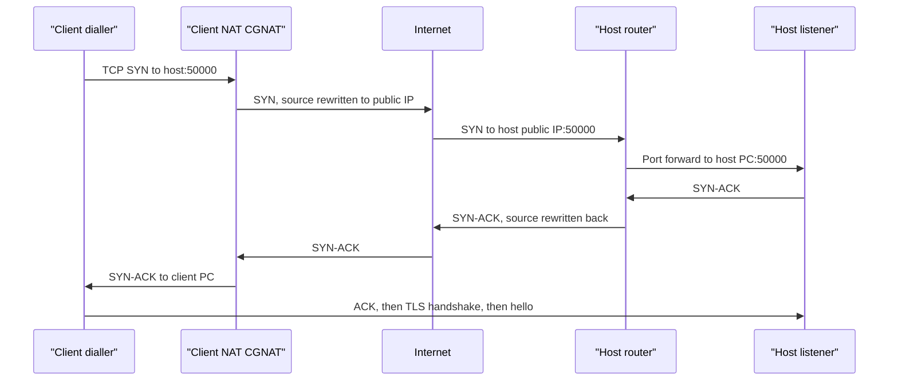
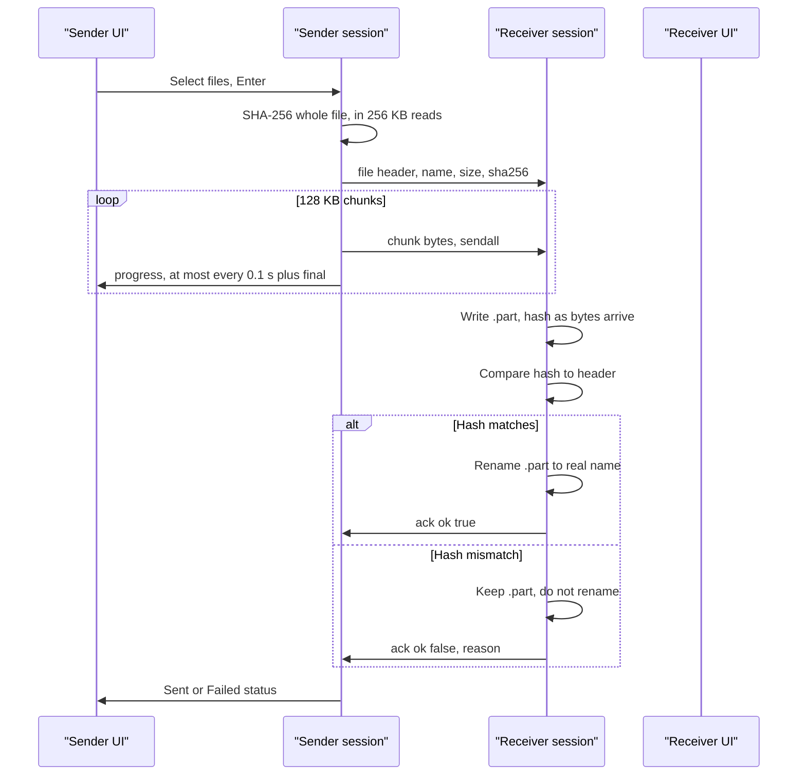
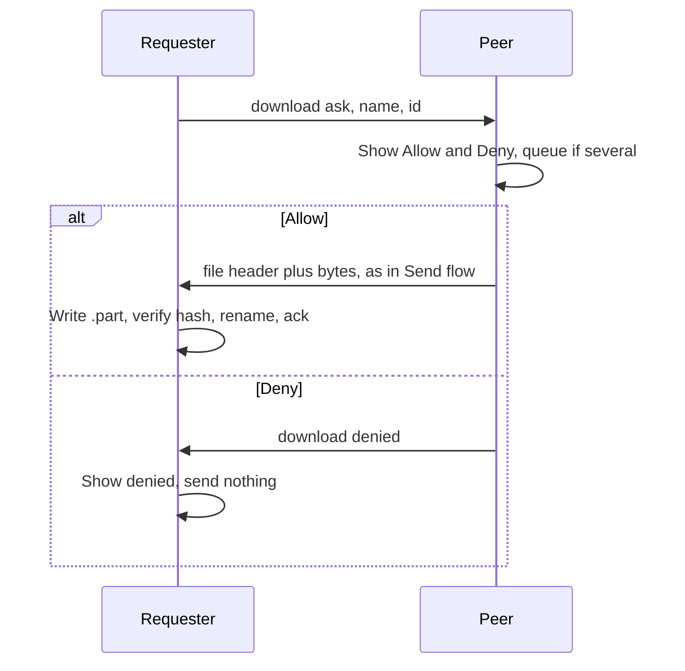
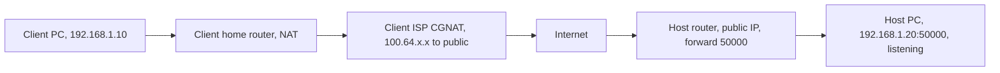

# Architecture

This page covers terminology first, then layers, protocol, flows, and NAT behaviour. It describes the system, not individual source files. For source files, see [project-structure.md](project-structure.md).

## Terminology

### Public IP and private IP

A private IP works only inside a local network, for example `192.168.1.10` at home. Private addresses are reused in millions of homes, so they are not reachable from the internet.

A public IP is the address a whole home or network presents to the internet. A website sees the public IP, not a PC private IP.

### NAT

NAT, Network Address Translation, is done by a home router. When a PC sends a packet out, the router rewrites the source from the private address to its public address, and remembers the mapping, so the reply goes back to the right PC. This lets many devices share one public IP.



### CGNAT

CGNAT, Carrier-Grade NAT, is NAT applied a second time, by the ISP. The ISP gives the home router another private address, in the shared range `100.64.0.0/10`, and the ISP NAT box translates many customers to a small pool of public IPs.



Consequences for Riptide:

- Behind CGNAT, no one on the internet can dial you directly, even with a port forward on your own router. The ISP box drops unsolicited inbound packets, because it has no mapping for you.
- You can still dial out. Outbound connections create a mapping in the CGNAT box, and replies to that outbound connection are allowed back in. The CGNAT side must be the Join side, the dialler, never the Create side, the listener.
- Riptide does not auto-detect this on Create Server. If you are behind CGNAT, you need to know that from your ISP or network setup, and use Join Server instead of Create Server, with the other side creating.

### Simple NAT and symmetric NAT

In simple, or cone, NAT, one private socket gets one public mapping, reused for every destination. Learning the public port once, via STUN, is enough to predict it for a peer.

In symmetric NAT, the same private socket gets a different public port for every different destination. The port learned from a STUN server is not the port used when talking to a peer. Riptide does not implement hole punching, port prediction, or a relay, so symmetric CGNAT is a hard limit.

### Port forwarding

Port forwarding is a rule on the Create side router: anything arriving at the public IP on port 50000 goes to a specific PC on the LAN, on port 50000.

Steps, in general terms:

1. Find the PC LAN address. On Windows, run `ipconfig`. On Linux, run `ip addr`.
2. Log in to the router, usually at `192.168.1.1` or `192.168.0.1`, and find Port Forwarding, Virtual Server, or NAT settings.
3. Add a rule: external port 50000, internal port 50000, protocol TCP, destination the PC LAN address.
4. Save. If the PC LAN address changes later, update the rule, or set a DHCP reservation for the PC in the router.

Port forwarding on your own router does nothing behind CGNAT, because the ISP box in front of your router has no such rule. Forwarding to a stale LAN address, after a DHCP lease change, is the most common "it worked yesterday" failure. Both peers must use the same port, currently 50000.

### Firewall

A firewall is separate from NAT. Even with a correct port forward, the Create side PC firewall can drop the inbound connection.

- Windows: on clicking Create Server, Riptide checks netsh inbound rules for TCP port 50000 and adds a rule named Riptide if it is closed, or enables an existing disabled rule with that name. If Riptide is not run as administrator, it asks once on that click, with a UAC prompt for netsh only. Riptide itself is not elevated and does not restart. A block rule for the same port wins over an allow rule, so Riptide reports the port as closed when a block rule exists, and does not prompt in that case, because an allow rule cannot fix it. Only the port 50000 rule is checked.
- Linux: on clicking Create Server, Riptide checks the active firewall, `ufw`, `firewalld`, `iptables`, or `nftables`, and adds a rule for TCP port 50000 if it is closed. It tries passwordless sudo first, so no prompt appears when that works. If sudo needs a password, it asks once on that click, with pkexec, for the firewall command only. pkexec uses --disable-internal-agent, so a machine with no graphical agent fails fast instead of prompting in the terminal, which would fight the UI. If no firewall is active, there is nothing to allow.
- Router firewall: some routers have a firewall in addition to NAT. A port forward rule normally implies an allow, but check a separate firewall toggle if your router has one.

The router forward remains a manual, one-time step on the Create side. The PC firewall rule is automatic when Riptide has the rights above, or after one elevation prompt on the Create click, and the Create page reports whether the rule was opened, cancelled, or could not be opened, with the manual command in the last two cases. The 20 second re-check while waiting never prompts. The Join side normally needs no inbound rule, because it makes an outbound connection.

### DDNS

Most home public IPs are dynamic. They change on router restart, or on ISP lease renewal. A raw IP shared today may point elsewhere tomorrow.

DDNS, Dynamic DNS, gives a hostname, for example `myname.ddns.net`, that always points to the current public IP. An updater, often built into the router, or a DDNS client on the PC, tells the DDNS provider when the IP changes.

For Riptide, the Create side should share a DDNS hostname, not a raw IP, if its IP is dynamic. The Join side can type a hostname, IPv4, IPv6, or `user@host`. DDNS solves a changing address. It does not bypass CGNAT. Behind CGNAT, a DDNS hostname points to the shared CGNAT public IP, which still cannot reach you. Share a hostname only with the intended peer, not publicly.

### IPv6

IPv6 addresses are globally unique, with no NAT in the normal case. If both sides have a unique global IPv6 address, they can connect directly over IPv6, even if one or both are behind CGNAT on IPv4, because there is no CGNAT box in the IPv6 path.

Riptide accepts IPv6 hosts, with or without brackets. IPv6 only helps if both sides have it. Asymmetry, one side with IPv6 and one side without, is common, and then IPv6 does not solve the connection.

### Same LAN, both CGNAT, and other combinations

| Situation | Action |
| --- | --- |
| Both on the same LAN | Dial the other PC private LAN address directly. No port forward, public IP, or DDNS needed. |
| Create side public, Join side CGNAT | Normal Riptide case. Create forwards 50000, Join dials the host public IP or DDNS hostname. |
| Both sides public | Either side can Create, the other Joins. |
| Both behind CGNAT on IPv4, neither has IPv6 | No direct connection. You need a third reachable peer, a relay, or IPv6. |
| Both have global IPv6 | Connect over IPv6. CGNAT on IPv4 does not matter. |
| Public IP just changed | Old address is dead. Use DDNS, or share the new address, and start a new session. An open TCP session does not survive an IP change. |
| Double NAT at home, router behind another router | Forward on both routers, or put the inner router in bridge or DMZ mode for the outer one, or simplify the chain. A private WAN address on your router is the symptom. |

## Layers

| Layer, TCP/IP model | Use in Riptide |
| --- | --- |
| Application | Textual UI, file manager, and session protocol: JSON headers, file messages, download requests, approvals, acks, pings. |
| Transport | One TCP connection per session. TCP gives ordered, reliable byte stream delivery, retransmission, and flow control. There is no UDP data path in the current version. |
| Internet | IPv4, and IPv6 when both sides have it. Addresses, routing, and NAT translation happen here. |
| Link and Physical | Wi-Fi, Ethernet, and ISP links. Riptide does not touch this layer directly. |

TLS sits between application and transport in practice. It encrypts the TCP byte stream, so JSON headers and file bytes are both encrypted in transit, even though they are framed at the application layer.



## System flow



### Listener

The Create side creates a TCP listening socket on all interfaces, `0.0.0.0:50000`, wraps it in a TLS server context with its own self-signed certificate, and blocks in `accept()`. It does not yet know who will connect. In parallel, it fetches its public IP, so the user sees the address to share with the client.

The listener socket closes when the page is left, so a later Create Server page in the same process can bind the same port again.

### Dialler

The Join side parses the hostname input to a bare host, opens a TCP connection to that host on port 50000, and wraps it in a TLS client context with its own self-signed certificate. TCP three-way handshake happens first, then TLS handshake, then an application `hello` with the device name.



If the host is behind CGNAT, the SYN is dropped at the ISP CGNAT box, because there is no mapping for it, and the connection times out. That timeout, with no error from a NAT box, is usually what a CGNAT failure looks like.

### Trust on first use

Neither side has a certificate signed by a public authority, because there is no authority involved and no account to tie a certificate to. Riptide uses fingerprint-based trust, like SSH host keys:

1. Each machine generates one self-signed RSA-2048 key and certificate on first run, stored in `~/.riptide/` as `identity.key` (0600) and `identity.crt`. The certificate is valid for 10 years and is not stored in `config.toml`.
2. On connect, each side computes the SHA-256 fingerprint of the other side certificate.
3. On a first connection, the user sees that fingerprint and presses Allow to trust it. The fingerprint is then saved with the peer in `config.toml`.
4. On a later connection, if the fingerprint changed, the session aborts. A changed fingerprint means a different machine, a reinstalled identity, or an interception. Riptide does not silently accept it.

TLS contexts use `CERT_NONE` at the library level, because Python built-in verification would reject a self-signed certificate outright. The real verification is the fingerprint check in Riptide itself. See [security.md](security.md).

## Session protocol

One TCP connection carries control messages and file data. There is no separate data channel, no second port, and no parallel connection. A send lock makes each header plus bytes transfer atomic, so a control message cannot interleave in the middle of a file.

### Framing

Every message is:

```
4-byte big-endian length | JSON header | file bytes, if any, exactly header.size bytes
```

The length is the length of the JSON header only, not the file. The receiver reads exactly that many header bytes, parses the JSON, then, for a file message, reads exactly `size` bytes from the same stream.

### Message types

| Type | Direction | Meaning |
| --- | --- | --- |
| `hello` and `hello_ok` | Both, at handshake | Device name exchange, session open. |
| `file` | Either, after session open | Header carries `name` (basename only), `size`, and `sha256`. File bytes follow immediately. |
| `ack` | Receiver to sender, after a file | `ok` true if received hash matched, else false with a reason. |
| `download_ask` | Requester to peer | Request for a file. Carries `name` (absolute or peer-relative) and a request `id`. Nothing is sent yet. |
| `download_denied` | Peer to requester | Download was denied. Nothing is sent. |
| `ping` and `pong` | Either, every 10 s idle | Heartbeat, so NAT and firewall idle timeouts do not close a quiet session. TCP keepalive is also enabled. |
| `error` | Either | For example, "no such file" for a download request. |
| `bye` | Either, on leave | Clean session close. |

### Sending a file



Details:

- Hash before sending, not after. The sender hashes the whole file first, so the receiver knows what to expect before the first byte arrives. This is a separate pass, in 256 KB reads, not a load of the whole file into memory.
- Streaming after that. The file is sent in 128 KB chunks with `sendall`, so a multi-gigabyte file does not need multi-gigabyte RAM.
- One transfer at a time. The send lock means a session sends one file at a time, in batch order. A batch is sequential, not parallel.
- Progress throttling. Sender and receiver report progress at most every 0.1 seconds, plus always on the final chunk. Reporting on every chunk, as the sender originally did, lets the UI process a burst of callbacks almost instantly and compute speed 4 to 5 times too high, because speed is bytes divided by UI time, not network time. Transfer progress code also ignores updates less than 10 ms apart for speed, while still updating the progress bar.

### Requesting a file



The requested name can be absolute on the peer, or relative to the peer launch folder. The file header sent back carries only the basename, so the receiver always saves into its own launch folder, never into an arbitrary path supplied by the peer. That basename-only rule blocks path traversal from a peer-supplied path.

## NAT packet flow



Packet view, for one SYN from client to host:

1. Client PC sends from `192.168.1.10:ephemeral` to `host-public-IP:50000`.
2. Client home router rewrites source to its WAN address, for example `100.64.1.10:ephemeral2`, and remembers the mapping.
3. ISP CGNAT rewrites source again to a shared public IP and port, and remembers that mapping.
4. Host router receives the packet at its public IP on port 50000, applies the port-forward rule, and rewrites destination to `192.168.1.20:50000`.
5. Host PC replies, and each NAT box reverses its mapping on the way back.

If step 4 has no port-forward rule, or step 3 has no outbound mapping because the host never dialled out, the packet is dropped. There is no error message from a NAT box, just silence and then a timeout, which is why CGNAT failures are confusing to debug.
